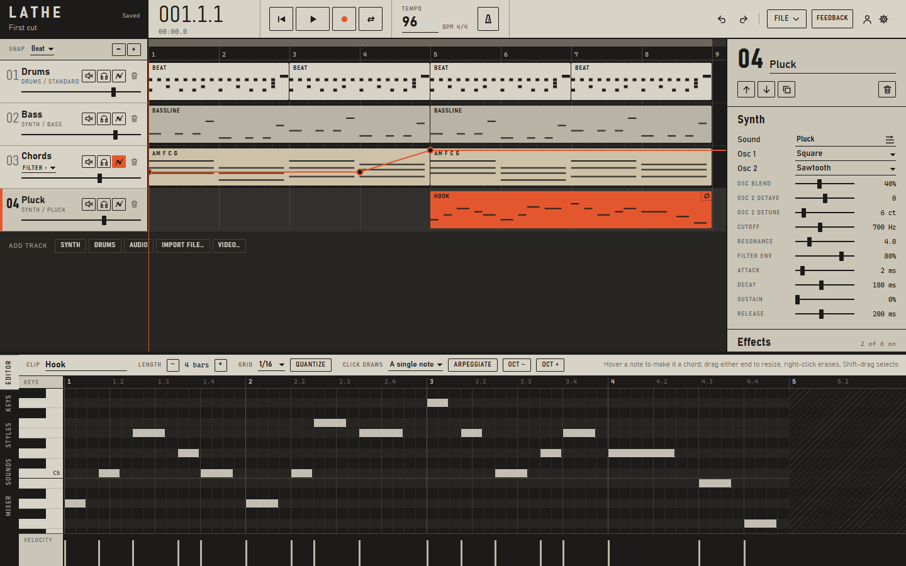
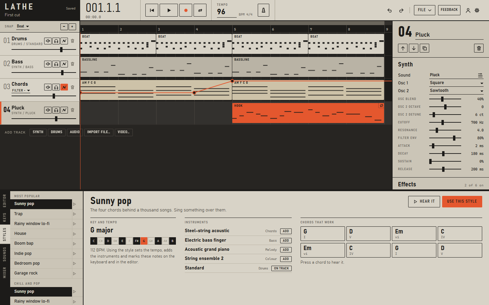

# Lathe

A music studio (DAW) that runs in the browser: write, record, mix and score to video. Nothing to install and no build step.

**Open it:** https://bentokaz.github.io/lathe/

Made by bentokaz as a school project.



## What it does

- **Timeline** with synth, drum and audio tracks. Clips can be moved, trimmed, split, copied and looped by dragging their corner.
- **Piano roll** with chord stamping, hover-a-note-to-make-a-chord, arpeggiate, quantize and velocity.
- **On-screen keyboard** with chord pads and an arpeggiator. The computer keyboard and MIDI keyboards play it too.
- **More than 150 sounds**: modelled guitars and ukulele, built-in synths, drum kits, and the 128 General MIDI instruments, which download the first time they are used.
- **Styles** for 35 kinds of music, most popular first. A style sets the key, tempo and instruments and marks the notes and chords that fit. The play button gives an 8-bar preview, and **Write backing** writes chords, bass and drums that come out differently every time. **New variation** gives another take; the melody is up to you.
- **Mixer** with EQ, drive, compressor, chorus, delay and reverb, plus mute and solo.
- **Automation** for volume, pan, filter, reverb and echo, drawn as a line on each track.
- **Recording** of notes from the keyboard, or audio from a microphone.
- **Import**:
  - audio: WAV, AIFF, MP3, AAC/M4A, FLAC, OGG and Opus;
  - MIDI;
  - video: MP4, MOV, WebM, MKV and more;
  - Lathe project files.
- **Export**:
  - audio: WAV, AIFF, MP3, AAC and Opus;
  - MIDI;
  - the video with your music: MP4, MOV, WebM or MKV.

  Exports render faster than real time.
- **Video scoring**: add a film, drop markers on the moments to hit, and export the film with the music.
- **My songs**: every song is kept in the browser, with an optional account to open them anywhere. A share link gives a friend their own copy.
- **Tutorial**: 16 steps (gear menu, or the start screen).
- **14 colour themes** (gear menu).



## How to use it

1. Open the site. The start screen offers a blank song, a style, the tutorial or the demo song.
2. Press **Space** to play and pause. Double-click an empty part of a track to make a clip, then draw notes in the editor below.
3. Pick sounds in the **Sounds** tab, and a kind of music in the **Styles** tab.
4. Balance the tracks in the **Mixer**.
5. **File, Export** saves the song as audio, MIDI or video.

The gear menu lists every keyboard shortcut.

## Run it on your own computer

Start the small server and open http://localhost:5173:

```
node serve.js
```

On Windows, `Start Lathe.bat` does both.

## Switching on accounts (optional)

Without accounts, Lathe keeps songs in the browser, and **File, Save project file** makes a file you can carry. Accounts let you sign in on any computer and find your songs there. They use [Supabase](https://supabase.com), which has a free plan.

1. Make a free Supabase account and a **New project**. Any name works; pick the region closest to you.
2. Open **SQL Editor**, paste the script below, and press **Run**. It creates the song table and the audio storage, and sets rules so each person can only see and change their own songs.
3. Under **Authentication, Sign In / Providers, Email**, turn **Confirm email** off. Classmates can then sign in straight away. The free plan only sends a few emails an hour, which runs out quickly with a whole class signing up.
4. In **Project Settings**, find the **Project URL** and the **anon public** key (newer projects call it the **publishable** key; never use the secret or service_role key), and copy both into [`js/config.js`](js/config.js). This key is designed to be public.
5. Commit and push. Sign-in then appears under the person button and **File, My songs**.

```sql
create table public.songs (
  id text primary key,
  owner uuid not null default auth.uid() references auth.users on delete cascade,
  name text not null default 'Untitled',
  data jsonb not null,
  updated_at timestamptz not null default now()
);
alter table public.songs enable row level security;
create policy "Own songs only" on public.songs for all to authenticated
  using (owner = auth.uid()) with check (owner = auth.uid());

insert into storage.buckets (id, name, public) values ('audio', 'audio', false) on conflict do nothing;
create policy "Own audio only" on storage.objects for all to authenticated
  using (bucket_id = 'audio' and (storage.foldername(name))[1] = auth.uid()::text)
  with check (bucket_id = 'audio' and (storage.foldername(name))[1] = auth.uid()::text);
```

An account stores only an email address, a password (handled by Supabase, never seen by Lathe) and the songs.

Video is not uploaded. It stays on the computer it was added on.

## Credits

**Sampled instruments.** These are the General MIDI soundfonts from [midi-js-soundfonts](https://github.com/gleitz/midi-js-soundfonts) by Benjamin Gleitzman:

| Set | Soundfont | Licence |
| --- | --- | --- |
| A | MusyngKite | CC BY-SA 3.0 |
| B | FatBoy | CC BY-SA 3.0 |
| C | FluidR3 GM | CC BY 3.0 |

The guitars, ukulele, synths and drum kits are generated in the browser, so they use no recordings.

**Libraries:**

- [Mediabunny](https://mediabunny.dev) (MPL 2.0) for video and audio files;
- [lamejs](https://github.com/zhuker/lamejs) (LGPL 3.0) for MP3;
- [supabase-js](https://github.com/supabase/supabase-js) (MIT) for accounts.

The same list is in the app under the gear menu, **About and credits**.
